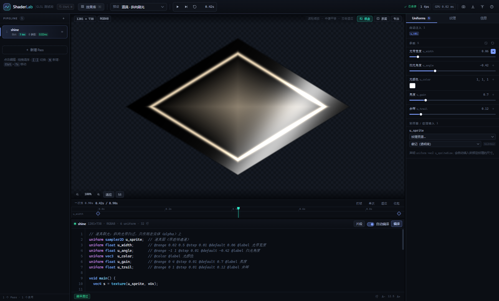
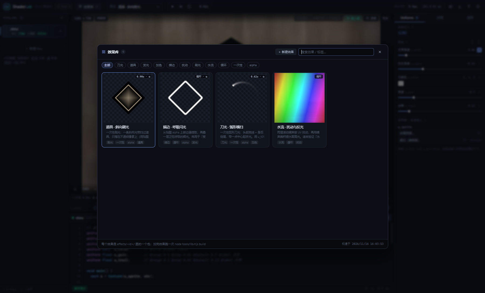

# ShaderLab · GLSL 着色器测试台

一个双击就能用的 WebGL2 片元着色器沙盒：左边挂多 Pass 后处理链，中间实时预览，右边调 uniform 和贴图，下面写 GLSL——改完自动重编译，用来快速验证算法效果。



- 纯静态：没有构建、没有依赖、不需要联网，`index.html` 双击即可（`file://` 也能跑）。
- 只要求浏览器支持 **WebGL2**（Chrome / Edge / Firefox 新版；Safari 15+ 理论可用但未实测）。
- 所有代码都是原生 WebGL2 + 原生 JS（classic script），方便直接改。

---

## 快速开始

1. 双击 `index.html`。
2. 左上「预设」挑一个例子先看效果。
3. 下方编辑器改 shader，停手 0.4 秒自动编译（或 `Ctrl + Enter` 立即编译）。
4. 右侧「Uniforms」拖滑块、「纹理」换输入图、左侧「新增 Pass」挂后处理。
5. 忘了命令在哪就按 `Ctrl + K`：命令面板能搜命令、预设、Pass、贴图。
6. 想看已经攒下来的效果，按 `Ctrl + L` 打开效果库；要动手做一个新的，图库右上角「＋ 新建效果」。

工程会自动保存到浏览器 IndexedDB，刷新/重开自动恢复；换机器用顶栏的「保存工程 / 打开工程」导出导入 JSON。

---

## 界面

| 区域 | 作用 |
| --- | --- |
| 顶栏 | 命令面板（`Ctrl K`）、效果库、预设切换、播放/暂停、单帧步进、时间归零、时间读数、自动保存状态、FPS / GPU 耗时、截屏、保存工程、打开工程、帮助 |
| 左栏 Pipeline | Pass 列表：单击选中、双击改名、拖拽排序、眼睛按钮启用/停用、每个 Pass 显示自己的 GPU 耗时；右键菜单（查看输出 / 启停 / 重命名 / 复制 / 下方插入 / 缓冲格式 / 倍率 / 上移下移 / 只显示这个 / 导出 PNG / 删除） |
| 中栏预览 | 滚轮以光标为锚点缩放、中键或空格拖动平移、双击适应窗口、左下角 适应 / 1:1、悬停取色（#RRGGBB + 浮点值）、`Shift + 点击`复制该点颜色、右上角「棋盘」切透明底色、「原图」对比与「专注」模式 |
| 中栏时间轴 | 预览底部：模式文案（无限 / 循环 / 一次性）、播放头、刻度、按 Pass 分组的轨道与关键帧；拖动定位、双击轨道补帧、点关键帧改缓动；右侧「打帧 / 循环 / 适应 / 收起」 |
| 中栏编辑器 | 行号、当前行高亮、GLSL 语法高亮、错误行标红、可点击错误列表、Tab/Shift+Tab 缩进、`Ctrl + /` 注释、片段菜单、字号增减、跳行、自动编译开关 |
| 右栏 Inspector | Uniforms：参数控件 + 筛选框 + 随机 / 复位 + 每个参数后的 `◇` 打帧按钮 + 采样器绑定；纹理：输入图、公共图库与资源库；信息：当前 Pass 参数、管线链、显存估算、设备能力 |

三栏之间的分隔条都可拖拽调宽窄（宽度会随工程保存）。

---

## 效果库

`effects/` 目录下的每个文件夹就是一个效果，按 `Ctrl + L` 或顶栏「效果库」打开图库：网格卡片、标签筛选、搜索，卡片缩略图是真实渲染出来的（带透明的地方显示棋盘格）。



```
effects/
  slash-arc/
    effect.json          # id / 名字 / 标签 / 时长 / 循环 / 输出尺寸与 alpha
    shaders/sweep.frag   # 每个 Pass 一个文件，可读可 diff
    input/…              # 可选：这个效果要用的贴图
  index.json             # 构建产物：给工具和 AI 读
  index.js               # 构建产物：给页面读（file:// 下用 <script> 载入）
```

- **加效果**：`node tools/new.mjs my-effect --name "我的效果" --tags 刀光,一次性 --duration 0.6 --alpha`，改完 `.frag` 跑一次 `node tools/lib.mjs build`，刷新页面就有。也可以在图库里点「＋ 新建效果」现场做一个，再导出成效果包导回来。
- **校验**：`node tools/lib.mjs check` 会查 id 与目录名一致、Pass 指向的 shader 存在、绑定目标存在、时长与尺寸合法；不合格直接失败，不会写坏索引。
- **贴图随效果走**：`inputs` 里可以写 `builtin:noise` 这种内置图，写 `library:wood-1853403` 引用公共图库，也可以写 `input/mask.png`，构建时内联成 dataURL，效果目录自包含。
- **一次性效果**（`loop: false` + `duration`）：预览下方出现时间轴，拖动即可 scrub 到任意进度，播放到末尾自动停；shader 里用 `u_t01`（0→1）驱动，别用 `u_time` 取模。
- **透明效果**（`output.alpha: true`）：预览右上角「棋盘」可切换背景（棋盘 / 深色 / 浅色 / 输入图），用来检查 alpha 与叠加观感。
- **关键帧**：效果包里可以带 `tracks`（`{ "p2": { "u_sweep": [{t, v, e}, …] } }`），打开就带着动画；在编辑器里打的帧也会一起导出。

字段、绑定写法与常见坑见 [`docs/EFFECT_FORMAT.md`](docs/EFFECT_FORMAT.md)。

---

## 时间轴与关键帧

预览下方的横条就是时间轴，播放头、刻度、轨道都在一起：

- **时间模式**：没写 `duration` 的效果是「无限时间」，`u_time` 一直涨；写了 `duration` 且 `loop` 为真的效果会循环绕圈（`u_t01` 也跟着重来）；`loop: false` 则播到末尾停住并停在最后一帧。
- **定位**：在轨道区点击或拖动即可停留到任意时刻（自动暂停）。
- **打帧**：右侧 Uniforms 里每个参数名后面有个 `◇`，点一下就在当前时刻给这个参数打帧，图标变成 `◆`；已经有动画的参数，直接拖滑块就会在当前时刻自动写帧。要一次补齐整个 Pass 的所有轨道，用时间轴右上角「打帧」或按 `K`。
- **补帧 / 删帧**：双击轨道在那一帧补一个关键帧；点关键帧弹出浮层，可改「到下一帧的缓动」（线性 / 缓入 / 缓出 / 缓入缓出 / 阶跃）、跳到这一帧、删除。
- **缩放刻度**：右侧「适应」把可见范围缩到刚好放下所有关键帧；「收起」把时间轴折起来只留一行。

---

## 公共图库与新建效果

**公共图库**：把要复用的素材图（png / jpg / webp）丢进 `library/`，跑一次 `node tools/lib.mjs build`，它们就会出现在「纹理」页的「公共图库」分组里：

- 点「用作输入」→ 成为首个 Pass 的输入图；点「用作背景」→ 铺在最底层的背景。
- 效果包的 `inputs` 里写 `"library:wood-1853403"` 就能引用同一张图，构建时不会把图复制进效果目录。
- 图库图片以 dataURL 内联进 `library/index.js`，所以 `file://` 直接打开也能用；合计超过 6MB 时构建会报错，请压缩后再放。

**新建效果**：入口有三处——效果库面板右上角「＋ 新建效果」、预设下拉最后一项、命令面板搜「新建效果」。表单填名称 / id / 标签 / 时长 / 背景图 / 循环 / 透明，创建后得到两个 Pass：

| Pass | 作用 |
| --- | --- |
| `p1 背景` | 把选中的图铺满画面（`u_bg` + `u_zoom`），想换图就在「纹理」页点别的素材 |
| `p2 效果` | 采样上一个 Pass（`u_src`），已经预置一条斜向扫光关键帧，改成你要的效果即可 |

做完点「导出效果包 JSON」下载 `<id>.effect.json`，在仓库根目录执行：

```bash
node tools/lib.mjs import fx-xxxx.effect.json   # 落到 effects/fx-xxxx/
node tools/lib.mjs build                        # 重建索引
```

刷新页面，它就在效果库里了，缩略图与标签一并生成。

---

## 写 shader 的约定

只要写入口函数，其余样板由构建器补：

```glsl
void main() {
  vec4 c = texture(u_tex, vUv);
  fragColor = vec4(c.rgb * 1.2, 1.0);
}
```

自动补齐：`#version 300 es`、`precision`、`in vec2 vUv`、`layout(location = 0) out vec4 fragColor`。
同时注入常量 `PI` / `TAU` 和工具函数 `sl_luma(vec3)`、`sl_rotate(vec2, float)`、`sl_hash21(vec2)`（用到了才注入）。

**旧写法也能跑**（GLSL1 / 其他引擎抄来的代码）：`varying` / `attribute` / `texture2D` / `textureCube` / `gl_FragColor` / `gl_FragData[0]` 会被自动改写。

### 自动 uniform

声明了就会每帧自动填值（不声明不会注入，避免和你的变量撞名）：

| 名字 | 类型 | 含义 |
| --- | --- | --- |
| `u_time` | float | 秒（可暂停 / 归零 / 步进） |
| `u_delta` | float | 上一帧耗时（秒），做时间积分用 |
| `u_frame` | float | 帧计数 |
| `u_resolution` | vec2 | 当前 Pass 的像素尺寸 |
| `u_texel` | vec2 | `1.0 / u_resolution`，做邻域采样 |
| `u_aspect` | float | 宽高比 |
| `u_mouse` | vec4 | xy = 光标（左下原点，0..1），zw = 按下位置 |
| `u_date` | vec4 | 年、月、日、秒 |
| `u_t01` | float | 一次性效果的进度 0→1（循环效果恒为 0） |
| `u_duration` | float | 效果的总时长（秒），没有则为 0 |
| `u_playing` | float | 是否在播放（1 / 0） |

`u_resolution` 是**当前 Pass** 的尺寸（`1/2×` 倍率的 Pass 会相应变小），`vUv` 恒为 0..1 且左下角是 (0,0)。

### 直接粘贴 Shadertoy 代码

```glsl
void mainImage( out vec4 fragColor, in vec2 fragCoord ) {
  vec2 uv = fragCoord / iResolution.xy;
  fragColor = vec4(0.5 + 0.5 * cos(iTime + uv.xyx + vec3(0, 2, 4)), 1.0);
}
```

检测到 `mainImage` 就会自动补 `iTime` / `iTimeDelta` / `iFrame` / `iResolution` / `iMouse` / `iDate` / `iChannel0..3`，并生成包装 `main()`。
`iChannel0` 默认接「本 Pass 的输入图」，`iChannel1..3` 默认关闭，可在 Uniforms 页改成别的贴图或中间 Pass。

---

## uniform 面板与注解

在 uniform 后面写注释，编辑器会把它们变成控件：

```glsl
uniform float u_sat;       // @range 0 2 @step 0.01 @default 1.05 @label 饱和度
uniform vec3  u_tint;      // @color @label 色调 @default 1 1 1
uniform float u_vignette;  // @range 0 1 @step 0.01 @default 0.25 @label 暗角
uniform sampler2D u_tex;   // @label 输入图
```

| 注解 | 作用 |
| --- | --- |
| `@range min max` | 滑块范围（默认 0..1；int 默认 0..10） |
| `@step s` | 滑块步长（默认 0.01） |
| `@default v` | 初值，向量按分量写：`@default 0.2 0.4 0.6` |
| `@label 文字` | 显示名（默认用变量名） |
| `@color` | 按颜色编辑（给 vec3 / vec4 用，vec4 才有 alpha 滑块） |
| `@hidden` | 不在面板显示 |

规则：注解写在变量同一行的尾部注释里，或写在它上一行的连续注释里都行。没写 `@default` 时，浮点取 0（若 `@range` 的下限大于 0 就取那个下限），颜色默认白、bool 默认关。

参数多的时候：面板顶部有「筛选参数」框（>5 个参数才出现）、一键随机、一键复位；**双击参数名**把这个参数复位回默认值；拖动时按住 `Shift` 用方向键可做 1/10 步长的微调。

### 采样器绑定

每个 `sampler2D` 在 Uniforms 页有一行绑定，可选：

| 绑定 | 取什么 |
| --- | --- |
| 上一 Pass 输出 | 前一个 Pass 的结果；第一个 Pass 取「输入图」 |
| 自身上一帧（反馈） | 本 Pass 上一帧（自动双缓冲 ping-pong），做拖尾/液体/迭代算法 |
| 纹理资源 | 资源库里任意一张图（内置 5 张或自己导入） |
| 指定 Pass | 任意 Pass 的输出，含「源图（原始输入）」——做 `原图 + 效果` 合成用 |
| 无 | 绑定黑色 1×1 纹理 |

声明 `uniform vec2 u_texSize;` / `uniform vec2 u_texTexel;` 会自动填入所绑定纹理的尺寸与 texel 大小（名字必须是「采样器名 + Size / Texel」）。

---

## 多 Pass 与后处理

- **新增 Pass**：插在当前选中 Pass 之后，自带一个 gamma + 去色的可跑模板，删掉重写即可。
- **每 Pass 独立设置**（右键菜单）：缓冲格式 `RGBA8` / `HDR (RGBA16F)`、分辨率倍率 `1×` / `1/2×` / `1/4×`、过滤与包裹（线性/最近、clamp/repeat）。
- **查看中间 Pass**：右键「查看此 Pass 输出」，预览区右上角出现「查看：xxx ✕」，点掉恢复看最终输出。
- **自反馈**：任意采样器绑到「自身上一帧」，引擎自动双缓冲，不会读写同一张图。
- 徽标 `HDR` 表示链上至少有一个 Pass 用浮点缓冲；设备不支持 `EXT_color_buffer_float` 时会退回 RGBA8 并在悬停提示里说明。
- 左栏每个 Pass 右上角显示自己的 GPU 耗时（`EXT_disjoint_timer_query_webgl2` 可用时），顶栏是整帧合计；没有计时扩展就退回 CPU 侧估算并标注 `CPU`。
- 「信息」页给出管线链与显存估算（宽 × 高 × 每像素字节 × 帧数），方便预估移动端开销。
- 最后一个 Pass 的输出会 blit 到画布，并按输出分辨率截屏。

---

## 预设

| 预设 | 说明 |
| --- | --- |
| 基础调色 | 单 Pass：饱和度 / 对比度 / 色调 / 暗角，最简起点 |
| 坐标画布 | 生成式：`vUv`、`u_aspect`、`u_mouse` 怎么用 |
| 波纹扭曲 | 按半径做相位偏移 + 通道错位 |
| 高斯模糊（2 Pass） | 可分离模糊：横向 + 纵向两趟 |
| 泛光 Bloom（4 Pass） | 亮度提取 → 模糊 ×2 → 与原图合成（含「源图」绑定示例） |
| Sobel 描边 | 3×3 邻域亮度梯度，可混回原图 |
| 色差与暗角 | RGB 三通道分开偏移 + 径向压暗 |
| 像素化 | 块状降采样 + 色阶量化 + 抖动 |
| 自反馈残影 | 上一帧衰减叠加，演示反馈缓冲 |
| 等离子生成 | 纯数学生成，不依赖输入 |

切换预设时，如果当前工程是改过的（`自定义`），会先确认再覆盖。内置预设下面是「效果库」分组，列出 `effects/` 里的全部效果。

---

## 效果库里的效果

| 效果 | 说明 |
| --- | --- |
| 刀光·弧形横扫 | 一次性：角度扫过，头部亮线 + 身后拖尾，带 alpha，可叠在武器上 |
| 道具·斜向刷光 | 一次性：一条斜向光带掠过贴图，只在不透明像素上出现（用贴图 alpha 遮罩） |
| 描边·呼吸闪光 | 从贴图 alpha 提边（Sobel）+ 外发光，亮度随时间呼吸，适合「可交互物件」高亮 |
| 水流·扰动与反光 | 两层滚动噪声推 UV + 乘积高光，适合验证「水面/热浪」类算法 |

写自己的效果时，先 `node tools/new.mjs` 生成骨架，再照着 `docs/EFFECT_FORMAT.md` 改。

---

## 保存 / 导出 / 素材

- **自动保存**：随便改都会存进 IndexedDB（不可用时回退 `localStorage`），刷新恢复；顶栏「自动保存」会短暂变绿显示「已保存」。
- **保存工程 / 打开工程**：导出 JSON（Pass、代码、参数、绑定关系、导入的贴图 dataURL 全在里面），方便存档、对比、发给别人。
- **导入贴图**：把图片拖进窗口直接粘贴也行；超过 2048 边长会等比缩小，避免显存和体积爆掉。
- **截屏**：按当前输出分辨率存 PNG（不是窗口截图，是渲染结果）。

---

## 快捷键

按 `Ctrl + K` 打开命令面板，所有命令（含预设、Pass、贴图）都能搜。其余快捷键：

| 按键 | 作用 |
| --- | --- |
| `Ctrl + K` / `Ctrl + P` | 命令面板 |
| `Ctrl + L` | 效果库 |
| `Space` | 播放 / 暂停 |
| `→` / `←` | 单帧前进 / 后退 |
| `R` | 时间归零 |
| `F` / `0` / 双击预览 | 适应窗口 / 100% / 适应窗口 |
| `B` 或按住 `\` | 对比原始输入图 |
| `Z`（`Esc` 退出） | 专注模式：只留预览 |
| `[` / `]` | 上一个 / 下一个 Pass |
| `N` / `Ctrl + D` | 新增 Pass / 复制当前 Pass |
| `K` | 当前时刻给这个 Pass 的所有轨道打帧 |
| `Ctrl + E` / `Del` | 启用或停用 / 删除当前 Pass |
| `Ctrl + ↑` / `Ctrl + ↓` | 上移 / 下移当前 Pass |
| `1` / `2` / `3` | 切到 Uniforms / 纹理 / 信息 |
| `Ctrl + Enter` | 立即编译当前 Pass |
| `Ctrl + S` | 导出工程 |
| `Ctrl + G` | 跳到行 |
| `Ctrl + +` / `Ctrl + -` | 编辑器字号 |
| `Ctrl + /` | 注释 / 取消注释 |
| `Tab` / `Shift + Tab` | 缩进 / 反缩进 |
| `Shift + 点击预览` | 复制该点颜色 |
| 拖入图片 | 导入为纹理资源 |

关闭「自动编译」后编辑器只在你按 `Ctrl + Enter` 或点「编译」时才编译，适合写一长段再一起调。

---

## 目录结构

```
shaderTest/
├── index.html          页面骨架（classic script，无构建）
├── css/styles.css      设计令牌 + 三栏布局 + 全部组件样式
├── js/
│   ├── util.js         小工具、SVG 图标、toast / modal / popover
│   ├── glsl.js         源码组装（补头、Shadertoy 包装、GLSL1 改写）、uniform 注解解析、语法高亮
│   ├── assets.js       纹理资源（内置 5 张 + 导入）与采样参数
│   ├── engine.js       WebGL2 引擎：编译缓存、多 Pass 渲染、ping-pong、GPU 计时、读像素、截屏
│   ├── editor.js       代码编辑器（高亮 / 行号 / 错误行 / 缩进 / 快捷键）
│   ├── uniforms.js     Uniforms 页渲染：参数控件 + 采样器绑定
│   ├── pipeline.js     左栏 Pass 列表（选中 / 改名 / 拖拽 / 启用停用 / 右键菜单）
│   ├── presets.js      10 套示例管线
│   ├── store.js        自动保存（IndexedDB → localStorage）、工程导入导出
│   └── app.js          装配：渲染循环、预览交互、编译调度、检查器、快捷键、图库
├── effects/            效果库（每个子目录一个效果包）
│   ├── <id>/effect.json + shaders/*.frag + input/
│   ├── index.json      构建产物（工具 / AI 读）
│   └── index.js        构建产物（页面读，file:// 下走 <script>）
├── library/            公共素材图（png / jpg / webp）+ 构建产物 index.json / index.js
├── tools/
│   ├── lib.mjs         扫描 / 校验 / 生成索引（build / check / list / import）
│   └── new.mjs         新建效果脚手架
├── docs/
│   ├── EFFECT_FORMAT.md 效果包格式与写作约定
│   ├── screenshot.png
│   └── library.png
```

---

## 自检

浏览器控制台里可以直接跑（预设是否都能编译过）：

```js
SL.test.checkAll();            // 遍历全部预设，返回每个 Pass 的编译结果
SL.test.loadPreset('bloom');   // 装载某个预设
SL.test.pixel(360, 240);       // 读预览中心像素 [r,g,b,a]（0..1）
SL.test.effects();             // 效果库索引里的全部效果对象
SL.test.loadEffect('slash-arc');   // 装载某个效果
await SL.test.thumb('slash-arc');  // 渲染一张该效果的缩略图 dataURL
SL.test.pack('my-id', '我的效果');  // 把当前文档打包成效果包对象（等同「下载效果包 JSON」）
```

---

## 已知限制

- 只有**片元**着色器全屏 Pass，没有可编辑的顶点着色器（顶点固定为覆盖全屏的三角形）。
- 参数面板支持 `float / int / bool / vec2 / vec3 / vec4`（含颜色）；`mat2/3/4` 声明不报错但没有控件，值恒为初值——需要的话在 shader 里用常量或自己拆成 vec。
- uniform 数组（如 `float foo[4]`）只给第一个元素的控件。
- 关键帧目前只作用于「参数」，采样器绑定与 Pass 启停不参与动画；缓动是固定的五种，没有自定义曲线编辑器。
- 纹理只支持 2D RGBA8 上传；没有 cube / 3D / 浮点纹理导入。
- 单 Pass 单输出，未暴露 MRT（多渲染目标）；需要多路输出就拆成多个 Pass。
- 采样器数量受设备限制（常见 16 个），每个 Pass 自己算。
- Shadertoy 兼容层里 `iChannelTime` 恒为 0（没有接播放器/视频解码）；`iChannelResolution` 有按绑定纹理填。
- 图库缩略图是打开图库时用 176×176 现渲的（4 个效果约 0.3 秒），效果多了以后会换成构建期预生成。
- 「新建效果」里生成的是**草稿**：还没跑 `import` + `build` 之前它只存在于浏览器本地，下拉里会标「（未落盘）」；导出的效果包如果用了自己拖进来的贴图，需要先把它放进 `library/` 再导出（导出面板里会提示）。
- 浏览器实测：Chromium 内核（Chrome / Edge）+ WebGL2 正常；Safari / 移动端未验证。
